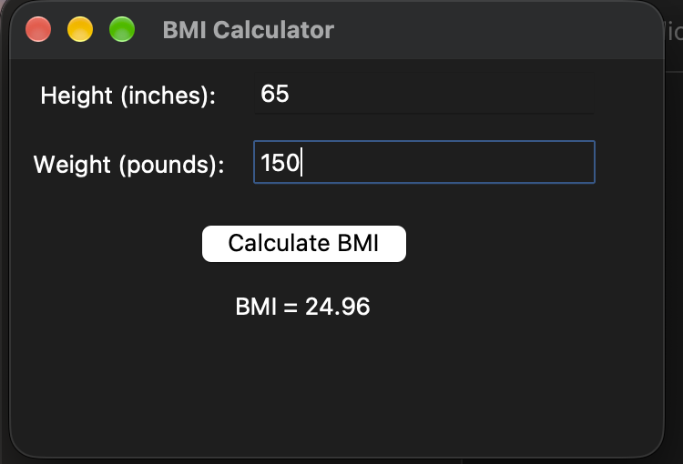

# BMI Calculator

A simple Python desktop app built with Tkinter that calculates Body Mass Index (BMI) from a height in inches and a weight in pounds.



## Course

**Class Activity** – Contemporary Business Applications Development I (MIS 310)
Central Connecticut State University · Dr. Armel Djangone · Fall 2026

## Features

- Input boxes for **height (inches)** and **weight (pounds)**
- **Calculate BMI** button shows the result rounded to 2 decimal places
- Uses the U.S. units formula: `BMI = weight / height² × 703`
- **Input validation:**
  - Zero or negative values show "Enter positive values."
  - Letters or empty boxes show "Please enter numbers only."

## Technologies Used

| Library | Purpose |
|---|---|
| `tkinter` | GUI: window, labels, entry boxes, button |

No extra packages are needed. Tkinter comes with Python.

## How to Run

1. Install **Python 3** from [python.org](https://www.python.org/downloads/).
2. Download or clone this repository.
3. Run:
   ```bash
   python bmi.py
   ```

## What I Learned

- Laying out a form with Tkinter's `grid()`, including `columnspan` and padding
- Reading user input with `.get()` and converting it with `float()`
- Linking a button to a function with `command=`
- Updating a label's text dynamically with `.config()`
- Validating input with `if/else` and `try/except`
- Formatting numbers with f-strings (`:.2f`)
